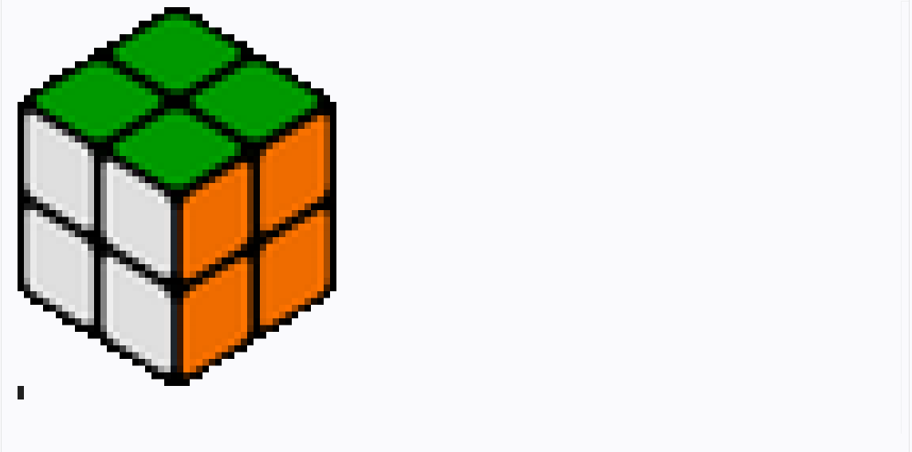
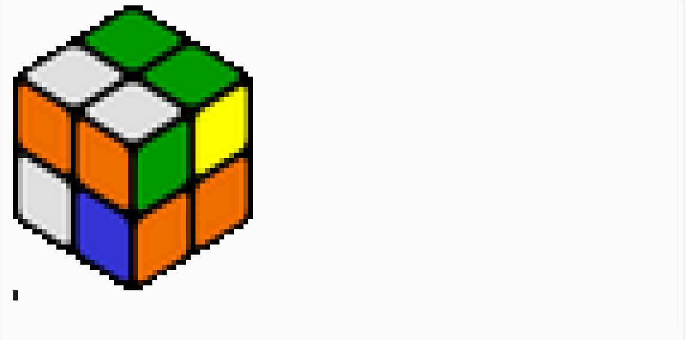
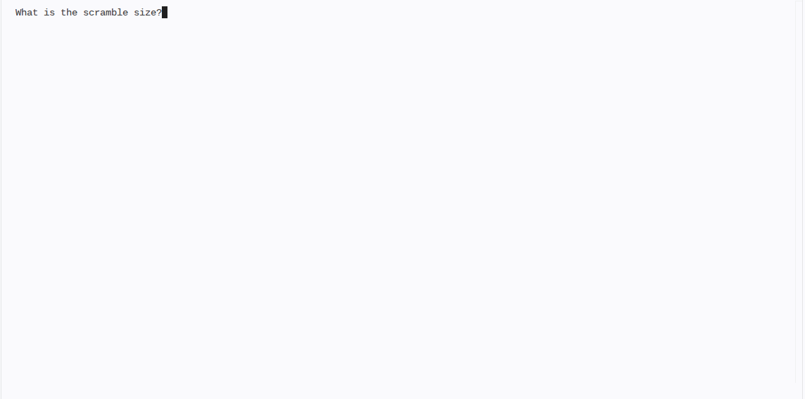
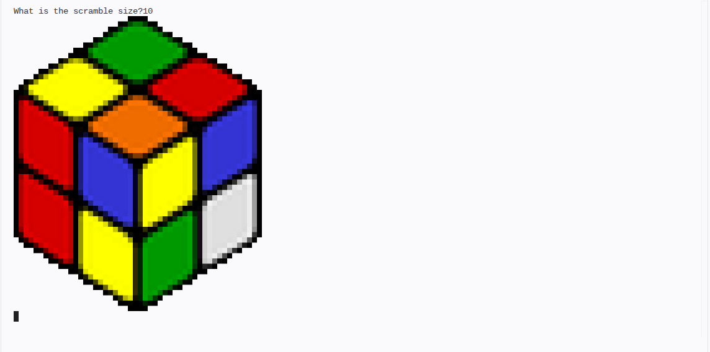

This is my attempt to make a Rubik's Cube 2x2 Simulator. I made it because I like rubik's cubes.

### Controls
* **F** - F turn (Front clockwise)
* **f** - F' turn (Front counter-clockwise)
* **D** - D turn (Down clockwise)
* **d** - D' turn (Down counter-clockwise)
* **U** - U turn (Up clockwise)
* **u** - U' turn (Up counter-clockwise)
* **R** - R turn (Right clockwise)
* **r** - R' turn (Right counter-clockwise)
* **L** - L turn (Left clockwise)
* **l** - L' turn (Left counter-clockwise)
* **B** - B turn (Back clockwise)
* **b** - B' turn (Back counter-clockwise)
* **S** - Solve Cube
* **s** - Scramble Cube
* **Up Arrow** - Rotate Cube up
* **Left Arrow** - Rotate Cube left
* **Right Arrow** - Rotate Cube right
* **Down Arrow** - Rotate Cube down

### How it works
* First, I pull the cube image from [Rubik Render](https://github.com/Dunamis4tw/rubik-render)
* Then I display it.
* After that, it's just reading user input
* For the solver, AI helped me made the script to generate the first face, then after that, I just made it go through the faces and finding cases, when it finds one, do its algorithm.
### Images

